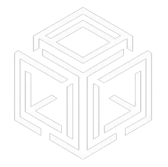

<p align="center">
  
</p>

# Atlas DePIN

**Atlas DePIN** (`atlasd`) is a Cosmos SDK blockchain that coordinates a decentralized
physical-infrastructure (DePIN) storage network. Storage providers contribute
disk capacity; users buy storage **subscriptions**, upload files, and providers
earn rewards by continuously proving those files are still being stored.

The chain is the indexer and settlement layer of the network: it tracks storage
as *byte-seconds*, orchestrates proof-of-persistence challenges, distributes
rewards, and never moves bulk file data on-chain (only metadata, merkle roots,
and proofs).

---

## Table of Contents

- [Overview](#overview)
- [Modules](#modules)
- [Requirements](#requirements)
- [Build](#build)
- [Run a local development chain](#run-a-local-development-chain)
- [Testing and linting](#testing-and-linting)
- [Repository layout](#repository-layout)

---

## Overview

| | |
|---|---|
| **Native token** | `uatl` ($ATL, 6 decimals) |
| **Address prefix** | `atl` (`atlvaloper`, `atlvalcons`, …) |
| **Coin type** | `118` |
| **Framework** | Cosmos SDK `v0.53`, CometBFT, IBC |

## Modules

### `x/storage` — storage network core

The heart of the chain. It maintains the credit pool, subscriptions, provider
registry, file index, challenge schedule, reward accounting, and the price feed.

### `x/filetree` — on-chain file/directory tree

A hierarchical namespace for organizing stored files. Nodes are merkle-linked
with parent/child relationships and support path traversal
(`PostNode`, `DeleteNode`, plus tree/path/children queries). This lets clients
represent folders and resolve paths on-chain without storing file contents.

## Requirements

- **Go ≥ 1.25**
- `make` (build/test targets)

## Build & Install

```sh
make build            # native binary → ./build/atlasd
make install          # go install into $GOBIN

./build/atlasd version
```

The build stamps version/commit metadata into the binary via ldflags.

## Run a local development chain

The repo is Ignite-scaffolded; `config.yml` defines a pre-funded `alice`/`bob`
and three validators. The quickest dev loop:

```sh
ignite chain serve            # spins up a single-node chain from config.yml
```

Or run a node manually with the built binary:

```sh
BIN=./build/atlasd
$BIN init mynode --chain-id atlas-1
$BIN keys add alice --keyring-backend test
$BIN genesis add-genesis-account $($BIN keys show alice -a --keyring-backend test) 1000000000000uatl
$BIN genesis gentx alice 100000000uatl --chain-id atlas-1 --keyring-backend test
$BIN genesis collect-gentxs
$BIN start
```

The default home directory is `~/.atlas` (override with `--home`).

## Testing and linting

```sh
make test        # go vet + govulncheck + unit tests
make test-unit   # unit tests only
make test-race
make test-cover
make bench
make lint        # golangci-lint
```

## Repository layout

```
├── app/                 # application wiring (module manager, ante handler, encoding)
├── cmd/atlasd/          # CLI entrypoint (root/tx/query commands, testnet helpers)
├── proto/atlas/         # protobuf definitions (storage, filetree)
├── x/
│   ├── storage/         # core DePIN module: credits, subs, providers, 
│   └── filetree/        # on-chain file/directory tree
├── docs/                # module docs + generated OpenAPI (docs/static/openapi.json)
├── testutils/           # keeper test-suite helpers (mock bank/auth, create helpers)
├── Makefile
└── config.yml           # Ignite dev-chain config
```
